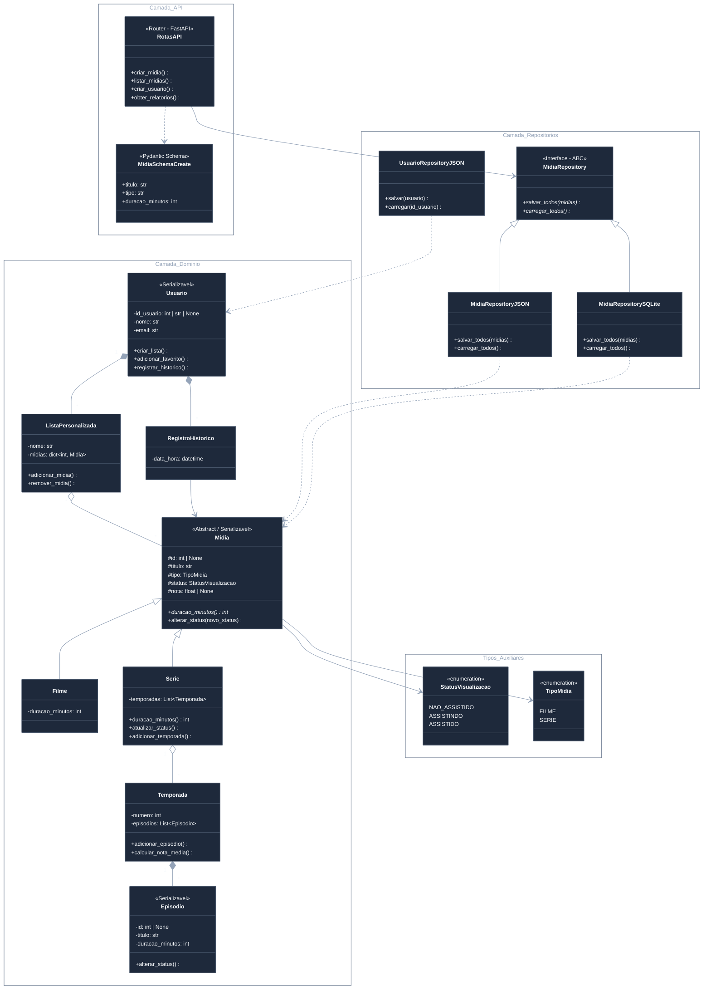

# Catálogo de Filmes e Séries

## 📌 Visão Geral

Este projeto consiste numa API desenvolvida em FastAPI (ou sistema de linha de comando CLI) para gerir um catálogo pessoal de filmes e séries. O objetivo do sistema é permitir que o utilizador acompanhe o progresso de visualização de séries, compare avaliações entre mídias, gira listas personalizadas e consulte relatórios de consumo. A modelação do sistema é orientada a objetos (POO), enfatizando conceitos como herança, encapsulamento, validações e composição.

## 🚀 Funcionalidades Principais

* **Cadastro de Mídias**: Permite o registo de filmes e séries com atributos como título, tipo, género, ano, duração e classificação indicativa. O sistema impede a duplicidade de mídias que possuam o mesmo título, tipo e ano.


* **Gestão de Séries e Episódios**: Suporta o registo de temporadas e episódios para a entidade Série. O sistema marca automaticamente a série com o status de "ASSISTIDA" assim que todos os seus episódios estiverem concluídos.


* **Sistema de Avaliações**: Os utilizadores podem avaliar filmes e episódios atribuindo uma nota numérica de 0 a 10. O sistema calcula de forma automática a nota média das séries e a nota geral do catálogo.


* **Histórico e Listas Personalizadas**: Regista a data e hora de conclusão de cada mídia. Permite criar listas personalizadas (ex: "Para assistir", "Favoritos") até um limite definido nas configurações e adicionar/remover mídias das mesmas.


* **Relatórios e Estatísticas**: Geração de relatórios que incluem a média de notas por género, o tempo total assistido por tipo de mídia, o Top 10 das mídias mais bem avaliadas e as séries com o maior número de episódios assistidos. Os relatórios consideram apenas mídias com o status "ASSISTIDO".


* **Configurações Dinâmicas**: Leitura de parâmetros através do ficheiro `settings.json`, que define a nota mínima para uma mídia ser "recomendada", o limite de listas por utilizador e o multiplicador de duração para conversão de tempo.


## 📂 Estrutura de Arquivos e Diretórios

A arquitetura do projeto está organizada em camadas, separando a interface, as regras de negócio e os modelos de domínio:
```
catalogo_filmes/
│
├── data/                        # Arquivos locais e de persistência
│   └── catalogo.db              # Arquivo do banco de dados SQLite (gerado automaticamente)
│
├── docs/                        # Documentação do projeto
│   └── README.md                # Documentação principal e diagramas Mermaid
│
├── requirements.txt             # Dependências do projeto (FastAPI, SQLAlchemy, etc.)
├── .gitignore                   # Ficheiros ignorados pelo Git (.env, __pycache__, catalogo.db)
│
├── src/                         # Código-fonte da aplicação (Encapsulamento)
│   ├── main.py                  # Ponto de entrada do FastAPI (agora protegido dentro de src)
│   │
│   ├── api/                     # Camada de Interface (Rotas HTTP)
│   │   ├── __init__.py
│   │   ├── rotas_midias.py
│   │   ├── rotas_usuarios.py
│   │   └── schemas.py           # Validações Pydantic
│   │
│   ├── core/                    # Configurações globais do sistema
│   │   ├── __init__.py
│   │   ├── configuracao.py      # Lógica para ler e validar o settings.json
│   │   └── settings.json        # Arquivo de parâmetros dinâmicos
│   │
│   ├── models/                  # Camada de Domínio (As suas classes POO)
│   │   ├── __init__.py
│   │   ├── enums.py
│   │   ├── exceptions.py
│   │   ├── filme.py
│   │   ├── mixins.py
│   │   ├── midia.py
│   │   ├── serie.py
│   │   └── usuario.py
│   │
│   ├── repositories/            # Camada de Acesso a Dados
│   │   ├── __init__.py
│   │   ├── database.py          # Configuração do ORM e conexão SQLite (substitui o antigo dados.py solto)
│   │   ├── midia_repository.py
│   │   └── usuario_repository.py
│   │
│   └── services/                # Regras de Negócio e Casos de Uso
│       ├── __init__.py
│       └── relatorio.py         # Cálculos de médias e estatísticas
│
└── tests/
    ├── __init__.py
    ├── conftest.py              # Fixtures globais (ex: banco SQLite em memória para os testes)
    ├── test_api.py              # Testes de integração dos endpoints
    ├── test_midia.py            # Testes unitários puros das classes (sem banco de dados)
    └── test_relatorios.py       # Testes da lógica de relatórios
```

## 📊 Diagrama de Classes (UML)

Abaixo encontra-se a representação da modelação orientada a objetos do projeto, ilustrando os relacionamentos de herança, composição e agregação:




## 🛠️ Como Executar o Projeto

### Pré-requisitos
* Python 3.10+

### Instalação
1. Clone o repositório:
   ```bash
   git clone https://github.com/edson-santos0077/catalogo-de-filmes-e-series.git
   cd catalogo-de-filmes-e-series
   ```


## 🧪 Executando os Testes Automatizados

Para rodar a suíte de testes com o `pytest`, execute:
```bash
py -m pytest -v
```
