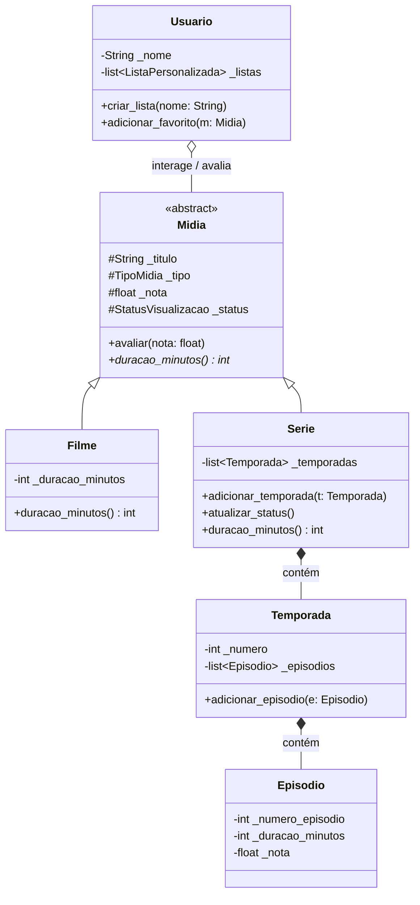

# Catálogo de Filmes e Séries

Aluno: Edson Oliveira Santos
Matrícula: 2026002630
Disciplina: ES0008 - PROGRAMAÇÃO ORIENTADA A OBJETOS

## 📌 Visão Geral

Este projeto orientado a objetos (POO) desenvolvido em Python para a gestão de um catálogo pessoal de filmes e séries. O sistema permite acompanhar o progresso de visualização, gerir episódios e temporadas, avaliar mídias, organizar listas personalizadas e consultar estatísticas e relatórios avançados de consumo.

A arquitetura adota o padrão **`src-layout`**, separando com clareza as camadas de domínio, persistência, regras de negócio e interface.

---

## 🛠️ Decisões de Arquitetura & Padrões de Projeto

### 1. Modelação Orientada a Objetos (POO)
- **Hierarquia de Domínio e Polimorfismo**: A classe abstrata `Midia` estabelece o contrato para `Filme` e `Serie`. Métodos abstratos como `duracao_minutos` garantem que cada subclasse calcule a sua duração adequadamente (duração fixa em filmes vs. soma dinâmica das temporadas e episódios em séries).
- **Composição e Agregação**: A classe `Serie` compõe `Temporada`, que por sua vez contém instâncias de `Episodio`. A integridade das relações é mantida através de métodos dedicados (`adicionar_temporada`, `adicionar_episodio`).
- **Encapsulamento Rígido**: Todos os atributos de estado interno são protegidos (prefixo `_`) e expostos via `@property` e `@setter` com validações prévias de intervalo, tipo e formatação (ex.: notas restritas a $0.0 - 10.0$, títulos não vazios, tempos positivos).
- **Métodos Especiais (Dunder Methods)**:
  - `__eq__`: Comparação de mídias por ID ou combinação única de Título + Tipo + Ano.
  - `__lt__`: Ordenação automática de mídias com base na avaliação.
  - `__len__`: Contagem total de episódios em instâncias de `Serie` e mídias contidas em `ListaPersonalizada`.
  - `__str__` / `__repr__`: Exibição formatada e detalhada de representação das entidades.

### 2. Padrão Observer (Log de Eventos Desacoplado)
Para estender a aplicação com auditoria e logs sem acoplar I/O ou manipulação de ficheiros às entidades de domínio, foi implementado o padrão **Observer**:
- **`EventDispatcher` (Subject/Singleton)**: Gerencia centralizadamente as inscrições dos observadores e a emissão de eventos no sistema.
- **Observadores Concretos (`ConsoleLogger`, `FileLogger`)**: O `ConsoleLogger` imprime notificações em tempo real no terminal, enquanto o `FileLogger` registra eventos estruturados num ficheiro de auditoria local (`data/eventos.log`).
- **Eventos Disparados**: Alteração de status de visualização (`STATUS_ALTERADO`), avaliação de mídia (`MIDIA_AVALIADA`), criação de listas (`LISTA_CRIADA`) e atualização de histórico (`HISTORICO_REGISTRADO`).

### 3. Reutilização via Mixins
- **`AvaliavelMixin`**: Encapsula a lógica de atribuição, validação e notificação de notas.
- **`SerializavelMixin`**: Utiliza *reflection* (`inspect.signature`) e inspeção de dicionário interno para converter instâncias complexas (incluindo datas ISO 8601 e Enums) em dicionários primitivos e reconstruí-las via `from_dict`.

### 4. Camada de Persistência Flexível
- Acesso a dados abstraído pela interface `MidiaRepository`.
- Implementação ativa em SQLite (`MidiaRepositorySQLite`) com suporte ORM/Database, permitindo alternância simples para persistência em JSON (`MidiaRepositoryJSON`) configurável no `settings.json`.

### 5. Tratamento de Exceções Customizadas
Definição de exceções específicas de domínio (`ValorInvalidoError`, `EstadoInvalidoError`) em `src/models/exceptions.py`, impedindo que estados inconsistentes sejam propagados.

---

## 🚀 Funcionalidades Principais

- **Cadastro e Impedimento de Duplicados**: Inserção de filmes e séries impedindo mídias duplicadas com o mesmo título, tipo e ano.
- **Conclusão Automática de Séries**: Transição automática da série para `ASSISTIDO` assim que todos os seus episódios forem marcados como concluídos.
- **Listas e Favoritos**: Criação de listas temáticas personalizadas respeitando o limite máximo definido na configuração global (`settings.json`).
- **Relatórios & Estatísticas de Consumo**:
  - Média de notas por género cinematográfico/televisivo.
  - Tempo total assistido por tipo de mídia, convertido para horas com multiplicador configurável.
  - Ranking Top 10 das mídias com melhores avaliações.
  - Mídias mais assistidas e relatórios de progresso.

---

## 📊 Diagrama de Classes (UML)

<details>
<summary>🔍 Clique aqui para expandir o diagrama.</summary>



Nota: Um diagrama de arquitetura completo com as camadas de persistência e rotas da API encontra-se na pasta docs/.

</details>

---

## 📂 Estrutura de Arquivos e Diretórios

<details>
<summary>🔍 Clique aqui para expandir a arquitetura.</summary>

```text
catalogo_de_filmes_e_series/
│
├── data/                        # Arquivos de dados persistentes e logs
│   ├── catalogo.db              # Banco de dados SQLite gerado automaticamente
│   ├── catalogo.json            # Banco de dados JSON (alternativa de persistência)
│   └── eventos.log              # Log de auditoria (Observer FileLogger)
│
├── docs/                        # Documentação e artefatos visuais
│   ├── diagram.png              # Diagrama arquitetural completo
│   └── README.md                # Cópia local da documentação
│
├── src/                         # Código-fonte principal da aplicação
│   ├── api/                     # Camada de Interface (Endpoints HTTP / FastAPI)
│   │   ├── rotas_midias.py
│   │   ├── rotas_usuarios.py
│   │   └── schemas.py
│   │
│   ├── core/                    # Configurações globais e infraestrutura
│   │   ├── configuracao.py      # Leitor e validador do settings.json
│   │   ├── events.py            # EventDispatcher e interface Observer
│   │   ├── loggers.py           # ConsoleLogger e FileLogger
│   │   └── settings.json        # Arquivo de parâmetros dinâmicos (ativo)
│   │
│   ├── models/                  # Camada de Domínio (POO)
│   │   ├── enums.py             # Enums StatusVisualizacao e TipoMidia
│   │   ├── exceptions.py        # Exceções personalizadas de domínio
│   │   ├── filme.py             # Entidade Filme
│   │   ├── midia.py             # Classe abstrata base Midia
│   │   ├── mixins.py            # AvaliavelMixin e SerializavelMixin
│   │   ├── serie.py             # Entidades Serie, Temporada e Episodio
│   │   └── usuario.py           # Entidades Usuario, ListaPersonalizada e RegistroHistorico
│   │
│   ├── repositories/            # Camada de Persistência e Repositórios
│   │   ├── database.py          # Conexão
│   │   ├── midia_repository.py  # Acesso a dados das mídias
│   │   └── usuario_repository.py# Acesso a dados dos utilizadores
│   │
│   └── services/                # Regras de Negócio e Casos de Uso
│       └── relatorio.py         # Cálculos de relatórios estatísticos
│
├── tests/                       # Suíte de testes automatizados (pytest)
│   ├── conftest.py              # Fixtures e configuração de ambiente de teste
│   ├── test_api.py              # Testes de integração das rotas
│   ├── test_midia.py            # Testes unitários das entidades de domínio
│   └── test_relatorios.py       # Testes dos serviços estatísticos
│
├── main.py                      # Ponto de entrada da aplicação FastAPI
├── pytest.ini                   # Configuração do pythonpath para os testes
├── requirements.txt             # Dependências do projeto
├── seed.py                      # Script de povoamento inicial do banco de dados
└── settings.example.json        # Exemplo de configuração exigido pela rubrica
```
</details>

---

## ⚙️ Configurações Dinâmicas (`settings.json`)

O sistema lê dinamicamente o arquivo `src/core/settings.json`, permitindo ajustar comportamentos operacionais sem necessidade de recompilação ou alteração do código-fonte:

```json
{
    "nota_minima_recomendado": 8.0,
    "limite_listas_usuario": 10,
    "multiplicador_duracao": 1.0,
    "casas_decimais_tempo": 2,
    "backend_persistencia": "sqlite"
}
```

- **`nota_minima_recomendado`**: Nota de corte para rotular uma mídia como "Recomendada"
- **`limite_listas_usuario`**: Quantidade máxima de listas personalizadas por usuário.
- **`multiplicador_duracao`**: Fator multiplicador para cálculo de tempo total assistido (ex.: conversão de escala).
- **`backend_persistencia`**: Define o motor de dados ativo (`sqlite` ou `json`).

---

## 🛠️ Como Executar o Projeto

### Pré-requisitos
- Python 3.10 ou superior instalado.

### 1. Instalação de Dependências
Clone o repositório e instale as dependências necessárias:

```bash
git clone https://github.com/edson-santos0077/catalogo-de-filmes-e-series.git
cd catalogo-de-filmes-e-series
pip install -r requirements.txt
```

### 2. Povoar o Banco de Dados (`seed.py`)
Para popular a base de dados SQLite com registros iniciais de filmes, séries, episódios e avaliações:

```bash
python seed.py
```

### 3. Executar o Servidor API
Inicie o servidor local FastAPI via Uvicorn:

```bash
uvicorn main:app --reload
```
Acesse a documentação interativa da API em `http://127.0.0.1:8000/docs`.

---

## 💡 Exemplos de Uso (API)

Após iniciar o servidor, pode interagir com a aplicação diretamente pelo **Swagger UI** (`http://127.0.0.1:8000/docs`) ou via terminal utilizando comandos cURL:

**1. Adicionar um novo Filme**
```bash
curl -X POST "[http://127.0.0.1:8000/midias/](http://127.0.0.1:8000/midias/)" -H "Content-Type: application/json" -d "{\"titulo\": \"O Senhor dos Anéis: A Sociedade do Anel\", \"tipo\": \"FILME\", \"genero\": \"Fantasia\", \"ano\": 2001, \"duracao_minutos\": 178, \"elenco\": [\"Elijah Wood\", \"Ian McKellen\"]}"
```

**2. Gerar Relatório do Top 10 Mídias**
```bash
curl -X GET "[http://127.0.0.1:8000/midias/relatorios/top10](http://127.0.0.1:8000/midias/relatorios/top10)" -H "accept: application/json"
```

**3. Obter Média de Notas por Género**
```bash
curl -X GET "[http://127.0.0.1:8000/midias/relatorios/notas-por-genero](http://127.0.0.1:8000/midias/relatorios/notas-por-genero)" -H "accept: application/json"
```

**4. Obter Tempo Total Assistido por Tipo (Filmes vs Séries)**
```bash
curl -X GET "[http://127.0.0.1:8000/midias/relatorios/tempo-total-por-tipo](http://127.0.0.1:8000/midias/relatorios/tempo-total-por-tipo)" -H "accept: application/json"
---
```

## 🧪 Executando os Testes Automatizados

A suíte de testes utiliza o `pytest` e cobre a criação de objetos, validações de atributos, cálculo de relatórios e regras do Observer:

```bash
py -m pytest -v
```
